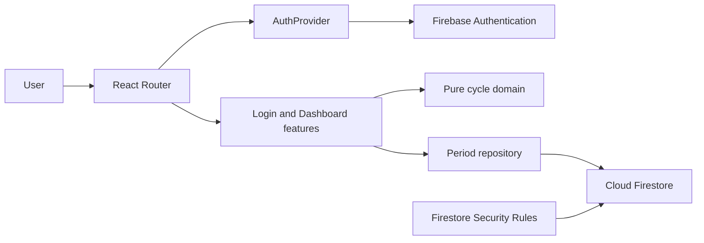

# Cycle | Privacy-conscious period tracker

Cycle is a mobile-first period tracker built with React, TypeScript, Firebase Authentication, and Cloud Firestore. It records period dates and estimates the next cycle from a user's history. Estimates are informational, not medically validated, and are labeled preliminary when there is not enough history.

## Engineering Highlights

- **Explicit domain boundaries:** cycle calculations are isolated from React and Firebase, while feature screens own user interactions and services own persistence.
- **Calendar-safe date modeling:** period dates stay as local-calendar `YYYY-MM-DD` strings. Calendar-day arithmetic avoids converting user-entered dates through UTC timestamps.
- **Defensive data handling:** inputs are validated before writes, Firestore documents are checked when read, and Firestore Security Rules independently enforce ownership and record shape.
- **Transparent estimation:** invalid, duplicate, overlapping, and implausible records are surfaced for review instead of silently contributing to a prediction.
- **Production-minded delivery:** strict TypeScript, route-level lazy loading, environment-specific builds, PWA installation/update support, cache policies, and hosting security headers.

## Architecture



### Responsibilities

- `src/domain/cycle/` defines period types, calendar-date validation, interval filtering, and cycle predictions. It has no UI or Firebase dependency.
- `src/features/` contains the login and dashboard flows, including form validation, overlap checks, loading/error states, period history, and prediction presentation.
- `src/app/` owns authentication state and route protection. Dashboard and login screens are lazy-loaded, with loading fallbacks while routes resolve.
- `src/services/periodRepository.ts` is the Firestore boundary for period subscriptions and writes. It validates local records and checks remote document fields before returning typed data to the UI.
- `firestore.rules` applies user-scoped access and validates allowed fields, calendar dates, and server timestamps independently of client-side checks.

### Cycle calculation and data integrity

Dates are stored as `YYYY-MM-DD` strings and compared as calendar dates. Period duration is inclusive of both endpoints. Cycle intervals are measured between consecutive starts; intervals outside 15–45 days, duplicate starts, invalid dates, and overlapping periods are excluded and reported for review. Predictions use the mean of up to the six most recent plausible intervals, rounded to a whole day. If no plausible interval is available, the app uses a clearly labeled preliminary 28-day estimate.

The dashboard validates dates and checks for overlapping records before writes. The repository validates values again, Firestore Security Rules enforce each user's document boundary and schema, and server timestamps are used for audit fields. These layers protect different trust boundaries; client-side validation is not treated as a substitute for database rules.

## Technology

- React 19 and TypeScript with strict compiler checks
- Vite for development and mode-specific builds
- Firebase Authentication and Cloud Firestore
- `date-fns` for local calendar-date operations
- `vite-plugin-pwa` for the installable app manifest and service worker

## Run Locally

Requirements: Node.js 20+, npm, and a Firebase project.

1. Install dependencies with `npm install`.
2. Copy `.env.example` to `.env.local` and fill in the Firebase web app configuration.
3. In Firebase Console, enable Email/Password sign-in and create a user under Authentication > Users. The app does not provide public account registration.
4. Add local and deployed hostnames to Firebase Authentication's authorized domains.
5. Start the development server with `npm run dev`.

The app name and PWA short name are configured with `VITE_APP_NAME` and `VITE_APP_SHORT_NAME`. Firebase configuration uses `VITE_FIREBASE_API_KEY`, `VITE_FIREBASE_AUTH_DOMAIN`, `VITE_FIREBASE_PROJECT_ID`, and `VITE_FIREBASE_APP_ID`. Vite exposes `VITE_` variables to the browser bundle, so they must not contain server secrets. Firebase web configuration is client-side configuration; secure access through Firebase Authentication and Security Rules.

The project uses Vite modes named `dev` and `prod`. Shared values can go in `.env.local`; use `.env.dev.local` and `.env.prod.local` for machine-local mode-specific values. If Firebase is not configured, the app displays setup guidance rather than substituting fake authentication or offline data.

## Build and Deploy

| Command | Purpose |
| --- | --- |
| `npm run dev` | Start Vite in `dev` mode. |
| `npm run build:dev` | Run the TypeScript project build and create a `dev`-mode bundle. |
| `npm run build:prod` | Run the TypeScript project build and create a `prod`-mode bundle. |
| `npm run preview` | Preview the existing `dist/` build locally. |
| `npm run deploy:dev` | Build in `dev` mode and deploy Firebase Hosting to the `dev` project. |
| `npm run deploy:prod` | Build in `prod` mode and deploy Firebase Hosting to the `prod` project. |

Set the appropriate `VITE_APP_NAME`, `VITE_APP_SHORT_NAME`, and Firebase values in the environment for each mode. For mode-specific local files, use `.env.dev.local` and `.env.prod.local`. Configure the Firebase CLI project aliases before deploying. The deployment scripts publish Hosting only; Firestore rules and indexes are configured in `firebase.json` and can be deployed separately with `npx firebase deploy --only firestore --project dev` or `--project prod`.

The Hosting configuration provides SPA routing, security headers, long-lived caching for fingerprinted assets, and revalidation for the app shell, service worker, and manifest. The PWA precaches the app shell and static assets; Firestore responses are not cached. The Firestore emulator is configured on port `8080`:

```sh
npx firebase emulators:start --only firestore --project demo-c-tracker
```

## Verification

There is currently no automated test script configured. The build commands above run TypeScript checks before generating the Vite bundle. The Firestore emulator can be used for local backend development.